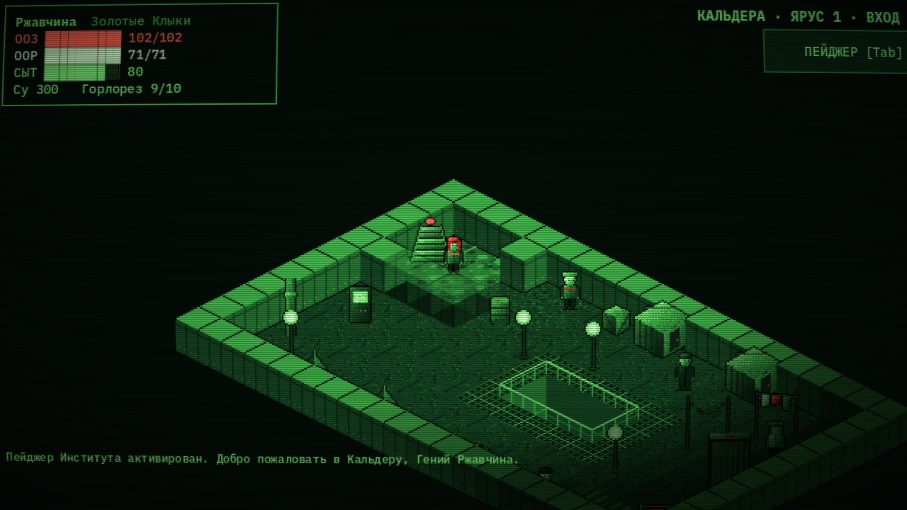
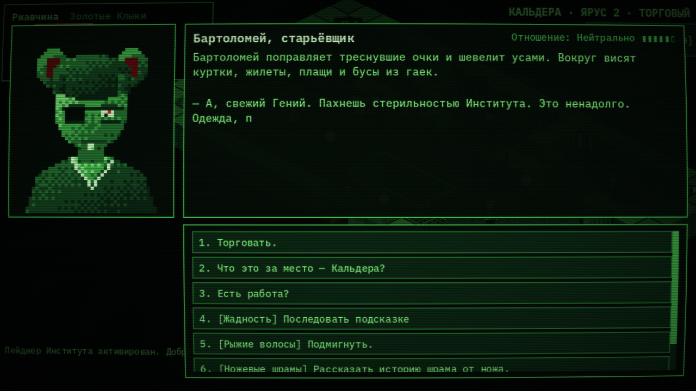
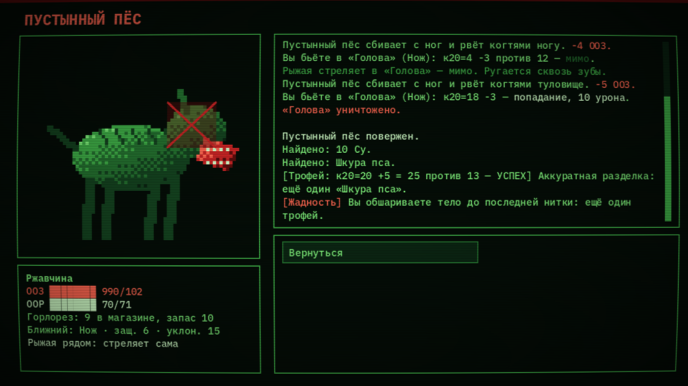
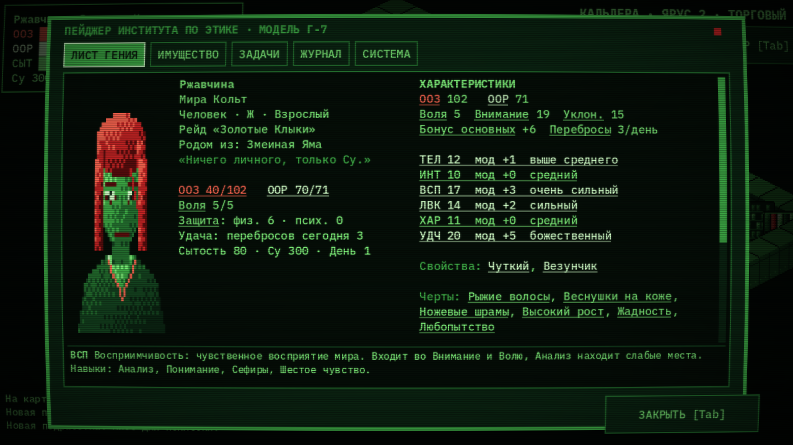

# Гении Подземки: Кальдера

Пошаговая RPG по авторскому миру «Гении Подземки»: изометрия, зелёный терминал с красным акцентом, бой по частям тела в духе Fear and Hunger, сцены-новеллы с портретами.

## ⬇ Скачать

**[Последняя версия — страница Releases](../../releases/latest)** → файл `GeniiPodzemki_vX.Y.zip`.

1. Распакуйте архив и запустите `GeniiPodzemki.exe` (Windows, ничего устанавливать не нужно).
2. Если Windows покажет «Система Windows защитила ваш компьютер», нажмите «Подробнее» → «Выполнить в любом случае». Так бывает со всеми неподписанными самодельными играми.

## Скриншоты

| | |
| --- | --- |
|  |  |
|  |  |

## Управление

| Действие | Клавиши |
| --- | --- |
| Ходить | клик по полу или WASD / стрелки |
| Говорить, действовать | клик по человеку или предмету, или E / Пробел рядом |
| Пейджер (лист, имущество, задачи, журнал, сохранение) | Tab |
| Выбор реплики | мышь или цифры 1–9 |
| Полный экран / окно | F11 |

## Что в игре

- Анкета Гения из 10 шагов: раса, фракция, возраст, место рождения, внешние черты и черты характера.
- Кальдера — Подземка в три яруса вниз: хирург, оружейник, лавка, доска подработок, бар «Клык» и Рыжая.
- Пустошь, карта мира, такси, логово псов, исследование окрестностей.
- Живые черты: черты Гения подсказывают в разговорах и срабатывают в бою.

## Для разработки

Проект Godot 4.3 (`project.godot`). Тексты диалогов — `scripts/story.gd`, справочники — `scripts/data.gd`, карты — `scripts/maps.gd`. Подробный список изменений — в `CHANGELOG.md`.
