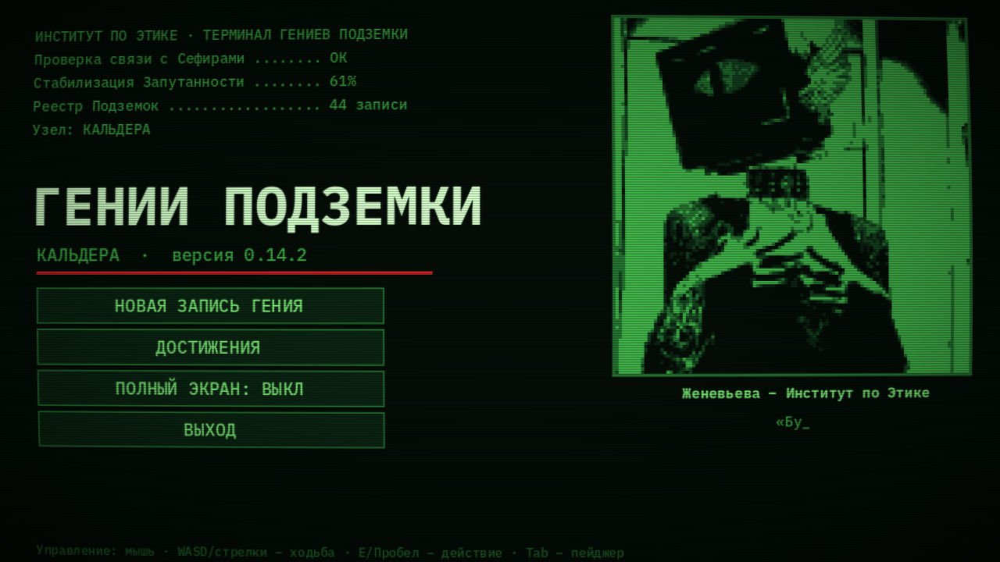
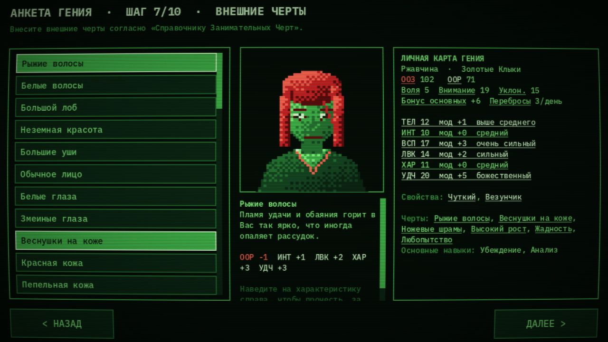
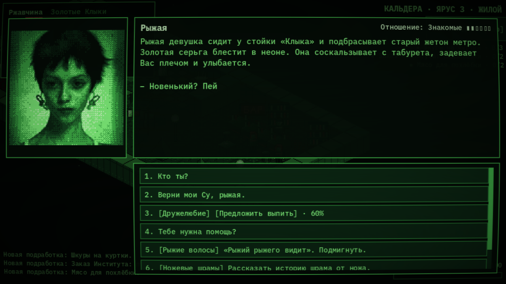
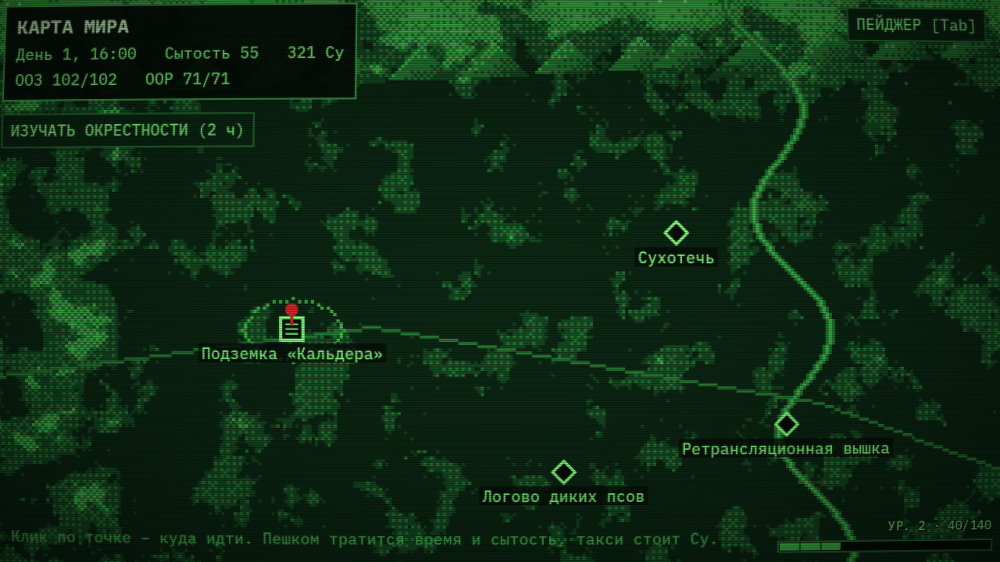
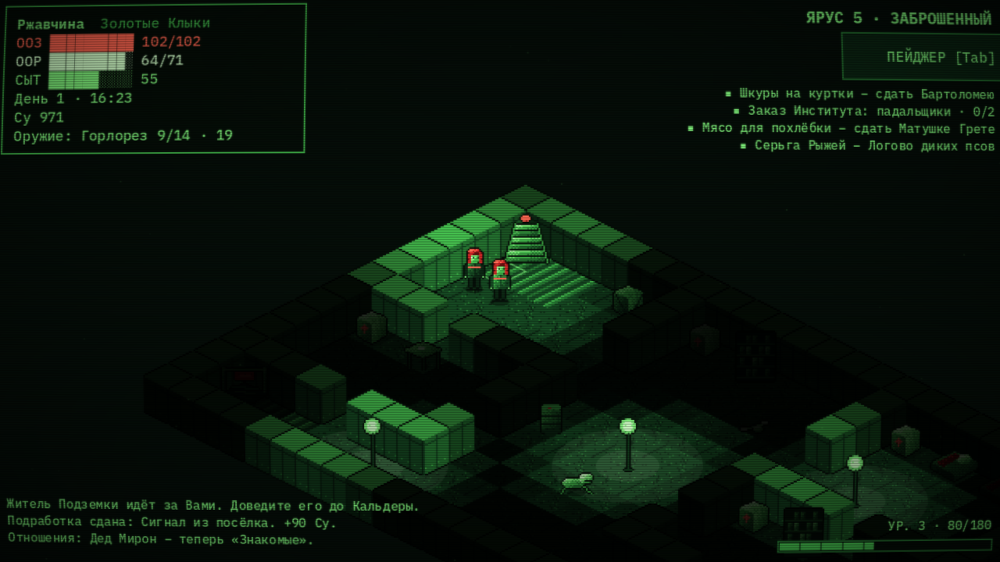

# Гении Подземки: Кальдера

**Пошаговая RPG о выживании в Подземках, городах-трущобах, уходящих на много этажей вниз.**

Зелёный терминал с красным акцентом, изометрия, бой по частям тела в духе Fear and Hunger и сцены-новеллы с портретами.

### [⬇ Скачать для Windows](../../releases/latest)

Версия 0.14.2 · бесплатно · установка не нужна

## Об игре

Мир после конца света. Наверху Пустошь, псы и падальщики, внизу Подземки, последние острова безопасности. Вы Гений с пейджером Института. Вам предстоит обжиться в Кальдере, найти работу, друзей и, может быть, любовь, а потом спуститься в заброшенные этажи чужих Подземок.

- **Свой Гений.** Анкета из десяти шагов: раса, фракция, возраст, место рождения, внешность и черты характера. Черты потом подсказывают в разговорах и срабатывают в бою.
- **Живая Подземка.** Четыре этажа Кальдеры: хирург, оружейник, лавка, доска подработок, бар «Клык», библиотека, день и ночь, погода.
- **Бой по частям тела.** Целитесь в голову, руки, ноги или туловище, следите за шансом попасть и не дайте покалечить себя.
- **Напарники.** Рыжая, Дана и Барбарис ходят с Вами в Пустошь и помогают в бою. С каждым свои сцены, просьбы и отношения из шести ступеней.
- **Пустошь и рейды.** Карта мира, пешие походы и такси, случайные встречи, логово псов и многоэтажные заброшенные Подземки.
- **Квест «Венок из ветвей барбариса».** Поездка на юг, в «Южную Звезду»: десять этажей вниз вместе с рыцарями Стальной Акколады.
- **Сохранение в любой момент**, уровни, достижения, книги.

## Скриншоты

| | |
| --- | --- |
|  |  |
|  |  |
|  |  |
|  |  |

## Как скачать и запустить

1. Откройте страницу **[Releases](../../releases/latest)** и скачайте файл `GeniiPodzemki_v0.14.2.zip` (около 32 МБ).
2. Распакуйте архив и запустите `GeniiPodzemki.exe`. Ничего устанавливать не нужно.
3. Если Windows покажет «Система Windows защитила ваш компьютер», нажмите «Подробнее», а затем «Выполнить в любом случае». Так бывает со всеми неподписанными самодельными играми.

Нужна Windows 10 или 11 (64 бит). Игра запускается в полный экран, переключить на окно можно клавишей F11.

Сохранения лежат в `%APPDATA%\Godot\app_userdata\Гении Подземки`. Кроме трёх ручных ячеек есть автосохранение при входе на каждую карту и после сна.

## Управление

| Действие | Клавиши |
| --- | --- |
| Ходить | клик мышью по полу, или WASD / стрелки |
| Говорить, открыть, войти | клик по человеку или предмету, или E / Пробел рядом с ним |
| Пейджер (лист Гения, имущество, задачи, журнал, сохранение) | Tab, I – сразу имущество, Esc – сразу система |
| Выбор реплики | мышь или цифры 1–9 |
| Полный экран / окно | F11 или Alt+Enter |

Эффект старого монитора выключается в пейджере, во вкладке «Система». На карте мира клик по точке показывает описание и выбор «Пешком» или «Такси», клик по пустому месту отправляет на разведку.

## Что нового в 0.14.2

- Рыцари-Бастионы ходят с Гением по всем этажам «Южной Звезды» и прощаются там, где стоят.
- Пещерные собаки вылезают быстрее, на этажах появились завалы.
- Барбарис переспрашивает, точно ли наверху безопасно, и решение можно поменять.
- Ремонт этажей виден: леса, рабочие, искры сварки и процент готовности.

Полная история версий в [CHANGELOG.md](CHANGELOG.md).

## Об авторах

Мир «Гении Подземки» и настольная d20-система придуманы Michael. Игра сделана на [Godot 4.3](https://godotengine.org/).

Для разработки

Проект Godot 4.3 (`project.godot`). Тексты диалогов в `scripts/story.gd`, справочники в `scripts/data.gd`, карты в `scripts/maps.gd`. Автопрогон: `GP_SMOKE=1 GP_SHOTS=<папка>` (см. `tests/smoke.gd`). Сборки (`.exe`, `.zip`) в репозиторий не кладутся, они выкладываются в Releases.

